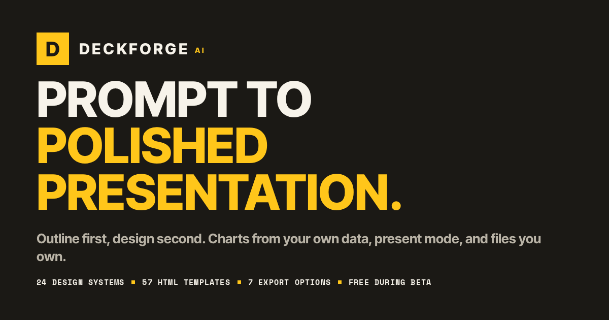

# DeckForge AI

Prompt-to-presentation studio: describe a topic or drop your own data, and get a
designed, editable 16:9 deck — then present it and export it (editable PPTX /
PDF / standalone HTML and more). 24 curated design systems, 57 HTML templates,
charts computed from your real numbers.



## Quick start

```bash
bun install
bun run db:push        # create the SQLite database (Prisma)
bun run dev            # dev server on :3000
```

Sign up from the app to own a private deck space — or just start as a guest:
each browser gets its own anonymous owner (httpOnly `df_anon` cookie), so decks
are never shared between visitors.

## Scripts

| Script | What it does |
| --- | --- |
| `bun run dev` | Dev server on port 3000 (Turbopack) |
| `bun run build` / `bun run start` | Production build (standalone output) and serve |
| `bun run lint` | ESLint (Next.js rules) |
| `bun run typecheck` | `tsc --noEmit` over the project (skills/examples excluded) |
| `bun run test` | Vitest unit tests (incl. automated WCAG contrast for all 24 themes) |
| `bun run db:push` | Push `prisma/schema.prisma` to the SQLite database |

## Environment

| Variable | Required | Purpose |
| --- | --- | --- |
| `DATABASE_URL` | yes | Prisma datasource. SQLite for local dev (`file:./db/custom.db`); use a hosted Postgres URL for production (serverless disks don't persist). See `.env.example`. |
| `NEXT_PUBLIC_SITE_URL` | no | Canonical/OG absolute URLs. Defaults to `http://localhost:3000`. |

The AI layer uses the sandbox-provided `z-ai-web-dev-sdk` server-side only —
no keys ship to the browser.

## Architecture

Overview and the full map live in [docs/FEATURES.md](docs/FEATURES.md); design
decisions in [docs/DESIGN.md](docs/DESIGN.md) and product framing in
[docs/PRODUCT.md](docs/PRODUCT.md).

```
src/
  app/            routes (/ , /create , /decks , /pitch , /demo , /settings , /login , /signup)
  app/api/        outline + slides generation (SSE), AI slide ops, data analysis,
                  decks & html-decks CRUD (owner-scoped), template content, exports
  components/     deck/ slide renderers · app/ studio & library · editor/ · pitch/
  lib/            design/themes.ts (24 token sets) · ai/ (strategies, SDK, guards)
                  deck/ (types, layout budgets) · data/parse.ts · export/ (pptx/html)
  server-side     every deck API filters by the session user or the per-browser
                  anonymous owner; uploaded files are parsed in the browser and
                  only compact summaries reach the server
```

**Design-token rule:** slide components read only CSS variables compiled from a
theme's tokens — no hardcoded colors or fonts, so a new theme instantly styles
every layout, chart and diagram.

**Data integrity:** the AI never computes your numbers. Uploads are parsed and
aggregated client-side; the AI only chooses *how* to chart them.

## Known limitations

- Guest decks are owned by a per-browser anonymous id; clearing cookies
  orphan them, and they don't follow you if you later sign up.
- Legacy decks created before owner-scoping (guest/global) are no longer
  visible; regenerate them.
- Generation runs 2 slides in flight — a queue with per-slide caching would
  help for 30-slide decks.
- PPTX diagram export linearizes layered flows into left-to-right boxes.
- PDF export relies on the browser print dialog (headless Chrome
  `--print-to-pdf` works well).
- Chart images rely on vision accuracy — always double-check extracted values.

## Security posture

- Owner-scoped CRUD on every deck route (session user or per-browser anon
  owner); foreign ids 404.
- AI-written deck HTML is served sandboxed (`CSP: sandbox` without
  `allow-same-origin` + `sandbox` iframe attr) — it cannot touch app cookies,
  storage or DOM.
- Request-body caps enforced server-side on all data/deck routes; rate limits
  on AI routes.
- `.env` is not committed (see `.env.example`); the SQLite database is
  git-ignored.

## License

[MIT](LICENSE) — bundled open-source frameworks and their licenses are listed
in [THIRD_PARTY_NOTICES.md](THIRD_PARTY_NOTICES.md).
